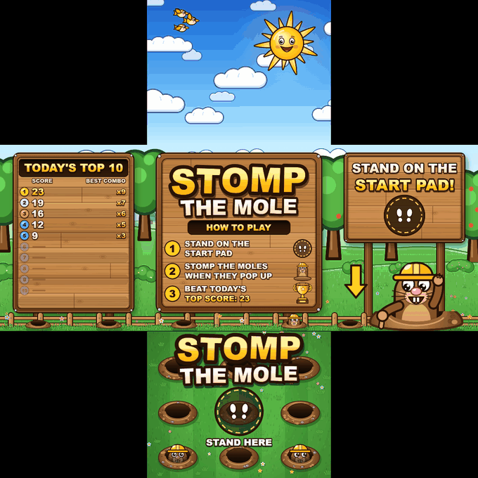
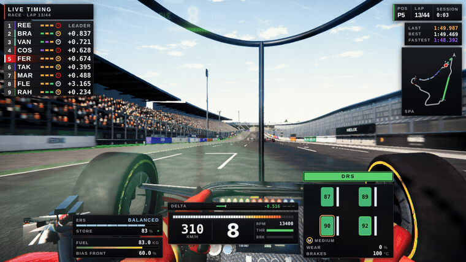

# Meersha Mohammed Jafar

Interactive & computer vision engineer in Dubai. I write the software behind
installations people walk up to and use with their hands, their voice, or a
physical object.

**What I build**

- **Gesture control:** a Nissan showroom configurator in Unreal Engine 5 you
  drive with your hands from across the room
- **Car showrooms:** table + wall experiences for the Cadillac Escalade and
  the Mercedes-AMG G 63. Place a tag on the table and the car rises above
  the glass like a hologram; on the wall you walk around the full 3D car
  with Ultraleap hand tracking. Scan a QR code to take your build home.
- **Object recognition (DISPLAX):** a table where turning a printed tag on
  the glass picks the story, installed for du; and a table + wall showroom
  where a tag grows a tree of brands on the table, and flicking one sends
  its products to the wall as 3D models
- **Interactive floor:** Stomp the Mole, an arcade game you play with your feet
  on an LED floor that senses every step. Moles pop up around you, the three
  walls run the countdown, the score and today's top 10, and the ceiling turns
  into a cartoon sky that bursts into fireworks for a new high score

  
- **AI assistants:** a 3D avatar kiosk that answers metro riders by voice, and
  JARVIS, my own voice layer for controlling my PC
- **AR:** a smart mirror that lets you try clothes on without taking them off
  the rail (in spec)
- **Real-time graphics:** raymarched worlds and audio-reactive shaders in GLSL
- **Racing game:** [APEX](https://github.com/meershamohammedjafar/apex-f1), a
  first-person Formula 1 game in Three.js with 120 Hz physics and a full race
  weekend at Spa against ten AI teams, playable in the browser or as a desktop app

  

**Tools:** Python, Unreal Engine, MediaPipe, WebGL/GLSL, Next.js, Flutter

Work: https://meershamohammedjafar.github.io/portfolio/
Email: meershajafar@gmail.com
If I don't reply, I'm out running.

Older repos here are my learning trail: Python exercises, a hand-rolled
WebRTC video chat, a Flutter puzzle game. I keep them public on purpose.
